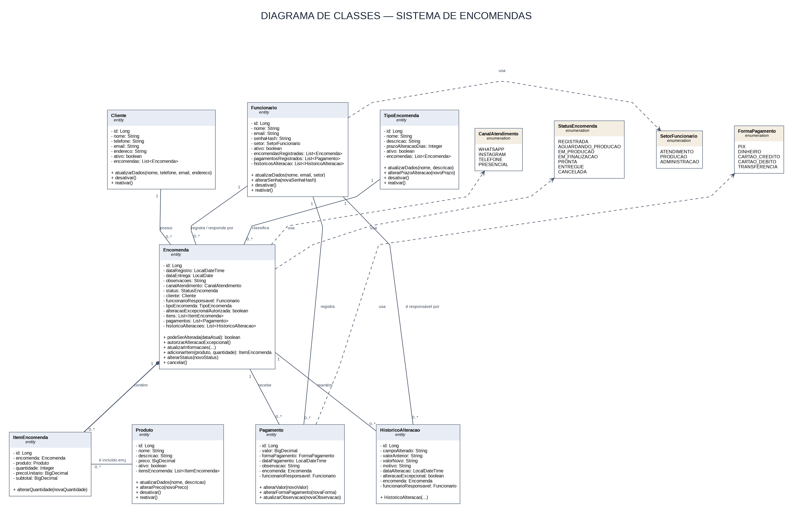

# Sistema de Gerenciamento de Encomendas

Projeto acadêmico da disciplina de **Back-End Avançado**. A aplicação é uma **API REST** em Spring Boot que organiza o registro e o acompanhamento de encomendas, do atendimento ao cliente até a entrega do pedido.

Depois da modelagem do domínio (2ª entrega), esta etapa implementa as camadas **Repository, Service, DTO, Mapper e Controller** dos módulos, além do **tratamento centralizado de exceções**.

---

## Sumário

1. [Sobre o projeto](#sobre-o-projeto)
2. [Objetivos](#objetivos)
3. [Tecnologias utilizadas](#tecnologias-utilizadas)
4. [Modelo de domínio](#modelo-de-domínio)
5. [Diagrama de classes UML](#diagrama-de-classes-uml)
6. [Arquitetura do projeto](#arquitetura-do-projeto)
7. [Organização do código](#organização-do-código)
8. [Endpoints da API](#endpoints-da-api)
9. [Tratamento de exceções](#tratamento-de-exceções)
10. [Como executar o projeto](#como-executar-o-projeto)
11. [Status do desenvolvimento](#status-do-desenvolvimento)
12. [Integrantes](#integrantes)

---

## Sobre o projeto

O **Sistema de Gerenciamento de Encomendas** é voltado para estabelecimentos que recebem encomendas por diferentes canais de atendimento: **WhatsApp, Instagram, telefone e presencialmente**. Os funcionários registram e gerenciam essas solicitações, acompanham o andamento da produção, registram pagamentos e mantêm um histórico das alterações feitas em cada pedido.

Cada tipo de encomenda possui um **prazo de alteração**. Depois dele, o pedido só pode ser modificado mediante uma **autorização excepcional**, que fica registrada no histórico.

## Objetivos

- Organizar o cadastro e as informações dos clientes.
- Gerenciar os funcionários, seus setores, senhas e situação (ativo/inativo).
- Registrar encomendas e seus respectivos itens.
- Controlar o ciclo de vida (status) das encomendas.
- Registrar os pagamentos realizados pelos clientes.
- Definir prazos para alterações, conforme o tipo de encomenda.
- Manter um histórico das alterações realizadas, identificando o funcionário responsável.

## Tecnologias utilizadas

| Tecnologia | Uso |
|---|---|
| **Java 21** | Linguagem de programação |
| **Spring Boot 4.1.2** | Framework da aplicação |
| **Spring Web MVC** | Criação dos endpoints REST |
| **Spring Data JPA / Hibernate** | Persistência e mapeamento objeto-relacional |
| **Jakarta Validation** | Validação dos dados de entrada nos DTOs |
| **Microsoft SQL Server** | Banco de dados relacional |
| **Maven** (com Maven Wrapper) | Gerenciamento de dependências e build |
| **IntelliJ IDEA** | Ambiente de desenvolvimento |

---

## Modelo de domínio

### Entidades

| Entidade | Responsabilidade |
|---|---|
| `Cliente` | Dados dos clientes que fazem encomendas. |
| `Funcionario` | Funcionários que registram encomendas, pagamentos e alterações. |
| `Produto` | Produtos disponíveis para encomenda, com preço atual. |
| `TipoEncomenda` | Classifica as encomendas e define o prazo (em dias) permitido para alterações. |
| `Encomenda` | Pedido registrado no sistema; é o centro do domínio. |
| `ItemEncomenda` | Produto e quantidade dentro de uma encomenda, com o preço praticado no momento do pedido. |
| `Pagamento` | Pagamentos registrados para uma encomenda. |
| `HistoricoAlteracao` | Registro de cada alteração feita em uma encomenda (campo, valor anterior, valor novo e motivo). |

### Enumerações (`shared/enums`)

| Enum | Valores |
|---|---|
| `CanalAtendimento` | `WHATSAPP`, `INSTAGRAM`, `TELEFONE`, `PRESENCIAL` |
| `StatusEncomenda` | `REGISTRADA`, `AGUARDANDO_PRODUCAO`, `EM_PRODUCAO`, `EM_FINALIZACAO`, `PRONTA`, `ENTREGUE`, `CANCELADA` |
| `FormaPagamento` | `PIX`, `DINHEIRO`, `CARTAO_CREDITO`, `CARTAO_DEBITO`, `TRANSFERENCIA` |
| `SetorFuncionario` | `ATENDIMENTO`, `PRODUCAO`, `ADMINISTRACAO` |

Os enums são persistidos como texto (`@Enumerated(EnumType.STRING)`), o que evita inconsistências caso a ordem dos valores mude.

### Relacionamentos (JPA)

Todos os relacionamentos são **bidirecionais**: o lado "muitos" é o dono da chave estrangeira (`@ManyToOne` + `@JoinColumn`) e o lado "um" usa `@OneToMany(mappedBy = ...)`. As associações `@ManyToOne` são `LAZY` e obrigatórias (`optional = false`).

| Relacionamento | Multiplicidade | Mapeamento |
|---|---|---|
| Cliente → Encomenda | 1 : 0..* | `Encomenda.cliente` / `Cliente.encomendas` |
| Funcionario → Encomenda | 1 : 0..* | `Encomenda.funcionarioResponsavel` / `Funcionario.encomendasRegistradas` |
| TipoEncomenda → Encomenda | 1 : 0..* | `Encomenda.tipoEncomenda` / `TipoEncomenda.encomendas` |
| Encomenda → ItemEncomenda | 1 : 0..* | `ItemEncomenda.encomenda` / `Encomenda.itens` |
| Produto → ItemEncomenda | 1 : 0..* | `ItemEncomenda.produto` / `Produto.itensEncomenda` |
| Encomenda → Pagamento | 1 : 0..* | `Pagamento.encomenda` / `Encomenda.pagamentos` |
| Funcionario → Pagamento | 1 : 0..* | `Pagamento.funcionarioResponsavel` / `Funcionario.pagamentosRegistrados` |
| Encomenda → HistoricoAlteracao | 1 : 0..* | `HistoricoAlteracao.encomenda` / `Encomenda.historicoAlteracoes` |
| Funcionario → HistoricoAlteracao | 1 : 0..* | `HistoricoAlteracao.funcionarioResponsavel` / `Funcionario.historicosAlteracao` |

O modelo não exigiu `@OneToOne` nem `@ManyToMany`: a relação N:N entre `Encomenda` e `Produto` foi modelada pela entidade associativa `ItemEncomenda`, porque ela carrega dados próprios (quantidade, preço unitário e subtotal).

### Encapsulamento e métodos de negócio

- **Não há setters genéricos.** O estado só muda por métodos com significado no domínio, que validam as regras antes de alterar os dados.
- O construtor sem argumentos é `protected` e existe apenas para o JPA; os objetos são criados por construtores que exigem os dados obrigatórios.
- O construtor de `ItemEncomenda` tem visibilidade de pacote: itens só são criados por `Encomenda.adicionarItem(...)`.
- `Encomenda` expõe suas coleções como listas somente leitura (`Collections.unmodifiableList`).

| Entidade | Métodos | Regras |
|---|---|---|
| `Cliente` | `atualizarDados`, `desativar`, `reativar` | Nome e telefone obrigatórios. |
| `Funcionario` | `atualizarDados`, `alterarSenha`, `desativar`, `reativar` | Armazena apenas o hash da senha. |
| `Produto` | `atualizarDados`, `alterarPreco`, `desativar`, `reativar` | Preço não pode ser negativo. |
| `TipoEncomenda` | `atualizarDados`, `alterarPrazoAlteracao`, `desativar`, `reativar` | Prazo de alteração não pode ser negativo. |
| `Encomenda` | `adicionarItem`, `alterarStatus`, `cancelar`, `atualizarInformacoes`, `podeSerAlterada`, `autorizarAlteracaoExcepcional` | Data de entrega não pode estar no passado; produto inativo não pode ser adicionado; transições de status seguem a ordem `REGISTRADA → AGUARDANDO_PRODUCAO → EM_PRODUCAO → EM_FINALIZACAO → PRONTA → ENTREGUE` (cancelamento permitido antes da entrega); encomenda entregue ou cancelada não pode ser alterada; após o prazo, a alteração exige autorização excepcional, válida para uma única alteração. |
| `ItemEncomenda` | `alterarQuantidade` | Quantidade maior que zero; guarda o preço do produto no momento do pedido e recalcula o subtotal. |
| `Pagamento` | `alterarValor`, `alterarFormaPagamento`, `atualizarObservacao` | Valor maior que zero; não é possível registrar pagamento para encomenda cancelada. |
| `HistoricoAlteracao` | construtor | Campo alterado e motivo obrigatórios; data registrada automaticamente. Registro imutável após criado. |

---

## Diagrama de classes UML

O diagrama apresenta as entidades, atributos, métodos modificadores, relacionamentos e multiplicidades, de forma coerente com o código implementado.

Arquivo: [`diagrama_classes.png`](diagrama_classes.png)



---

## Arquitetura do projeto

### Arquitetura escolhida: Arquitetura em Camadas (Layered Architecture)

Cada camada tem uma responsabilidade bem definida e só depende da camada imediatamente abaixo:

```text
Controller  →  recebe as requisições HTTP e devolve as respostas (usa DTOs)
    ↓
Service     →  orquestra os casos de uso e controla as transações
    ↓
Repository  →  acesso ao banco de dados (Spring Data JPA)
    ↓
Entity      →  modelo de domínio, com atributos, relacionamentos e regras de negócio
```

As camadas são organizadas **por módulo de negócio** (*package by feature*): cada módulo (`cliente`, `funcionario`, `encomenda` etc.) contém suas próprias camadas, de modo que tudo o que se refere a uma parte do negócio fica em um só lugar.

### Justificativa da escolha

**1. Necessidades do negócio.** O sistema gira em torno de cadastros (clientes, funcionários, produtos, tipos de encomenda) e de um fluxo central: registrar a encomenda, acompanhar a produção, receber pagamentos e registrar alterações. São operações bem delimitadas que se encaixam na sequência *requisição → regra de negócio → persistência*. As regras mais importantes ficam **dentro das próprias entidades**, então o Service apenas coordena os casos de uso e a regra continua válida independentemente de quem a chama.

**2. Complexidade do sistema.** É um sistema de **complexidade média**: oito entidades, um único banco relacional, uma única aplicação e nenhuma integração externa obrigatória. Arquiteturas como **Hexagonal / Clean Architecture** ou **microsserviços** trariam muitas classes, interfaces e custos de implantação sem benefício proporcional. A separação por módulos facilita uma eventual evolução, caso o sistema cresça.

**3. Características da equipe.** É o padrão estudado na disciplina e o mais usado com Spring Boot, que oferece suporte direto a cada camada (`@RestController`, `@Service`, `@Repository`, `@Entity`). A curva de aprendizado é baixa e há farta documentação.

### Regras de organização adotadas

- **Controllers** não acessam Repositories diretamente; sempre passam por um Service.
- **Controllers** recebem e devolvem **DTOs**, nunca entidades. A conversão é feita pelos **Mappers**.
- **DTOs de entrada** são validados com Jakarta Validation (`@Valid`, `@NotBlank`, `@Email`, `@Size` etc.).
- **Services** coordenam os casos de uso e as transações (`@Transactional`), delegando as regras às entidades.
- **Entities** concentram as regras de negócio e não dependem de nenhuma outra camada.
- Elementos usados por vários módulos (enums e exceções) ficam no pacote `shared`.

---

## Organização do código

```text
src/main/java/sistema_encomendas/
│
├── SistemaEncomendasApplication.java
│
├── cliente/
│   ├── controller/      ClienteController
│   ├── dto/             ClienteRequestDTO, ClienteResponseDTO
│   ├── entity/          Cliente
│   ├── mapper/          ClienteMapper
│   ├── repository/      ClienteRepository
│   └── service/         ClienteService
│
├── funcionario/
│   ├── controller/      FuncionarioController
│   ├── dto/             FuncionarioRequestDTO, FuncionarioResponseDTO
│   ├── entity/          Funcionario
│   ├── mapper/          FuncionarioMapper
│   ├── repository/      FuncionarioRepository
│   └── service/         FuncionarioService
│
├── tipoencomenda/
│   ├── controller/      TipoEncomendaController
│   ├── dto/             TipoEncomendaRequestDTO, TipoEncomendaResponseDTO, PrazoAlteracaoRequestDTO
│   ├── entity/          TipoEncomenda
│   ├── mapper/          TipoEncomendaMapper
│   ├── repository/      TipoEncomendaRepository
│   └── service/         TipoEncomendaService
│
├── encomenda/
│   ├── controller/      EncomendaController
│   ├── dto/             EncomendaResponseDTO, EncomendaServiceDTO
│   ├── entity/          Encomenda, ItemEncomenda
│   ├── mapper/          EncomendaMapper
│   ├── repository/      EncomendaRepository
│   └── service/         EncomendaService
│
├── produto/
│   └── entity/          Produto
│
├── pagamento/
│   └── entity/          Pagamento
│
├── historico/
│   └── entity/          HistoricoAlteracao
│
└── shared/
    ├── enums/           CanalAtendimento, FormaPagamento, SetorFuncionario, StatusEncomenda
    └── exception/       GlobalExceptionHandler, RecursoNaoEncontradoException, RegraDeNegocioException
```

### Situação das camadas por módulo

| Módulo | Entity | Repository | Service | DTO | Mapper | Controller |
|---|:---:|:---:|:---:|:---:|:---:|:---:|
| `cliente` | ✅ | ✅ | ✅ | ✅ | ✅ | ✅ |
| `funcionario` | ✅ | ✅ | ✅ | ✅ | ✅ | ✅ |
| `tipoencomenda` | ✅ | ✅ | ✅ | ✅ | ✅ | ✅ |
| `encomenda` | ✅ | ✅ | ✅ | 🟡 | ✅ | 🟡 |
| `produto` | ✅ | — | — | — | — | — |
| `pagamento` | ✅ | — | — | — | — | — |
| `historico` | ✅ | — | — | — | — | — |

✅ implementado · 🟡 estrutura inicial (em evolução) · — próxima etapa

---

## Endpoints da API

A API roda por padrão em `http://localhost:8080`. Os corpos de requisição e resposta são em JSON.

### Clientes: `/clientes`

| Método | Rota | Descrição |
|---|---|---|
| `POST` | `/clientes` | Cadastra um cliente |
| `GET` | `/clientes` | Lista clientes (filtros opcionais: `?ativo=true`, `?nome=`) |
| `GET` | `/clientes/{id}` | Busca um cliente pelo id |
| `PUT` | `/clientes/{id}` | Atualiza os dados do cliente |
| `PATCH` | `/clientes/{id}/desativar` | Desativa o cliente |
| `PATCH` | `/clientes/{id}/reativar` | Reativa o cliente |

### Funcionários: `/funcionarios`

| Método | Rota | Descrição |
|---|---|---|
| `POST` | `/funcionarios` | Cadastra um funcionário (senha obrigatória; e-mail único) |
| `GET` | `/funcionarios` | Lista funcionários (filtros opcionais: `?ativo=`, `?setor=`, `?nome=`) |
| `GET` | `/funcionarios/{id}` | Busca um funcionário pelo id |
| `PUT` | `/funcionarios/{id}` | Atualiza nome, e-mail e setor |
| `PATCH` | `/funcionarios/{id}/setor` | Altera somente o setor |
| `PATCH` | `/funcionarios/{id}/senha` | Altera a senha |
| `PATCH` | `/funcionarios/{id}/ativar` | Ativa o funcionário |
| `PATCH` | `/funcionarios/{id}/desativar` | Desativa o funcionário |

A senha nunca é armazenada em texto puro nem devolvida nas respostas: o service gera um hash (SHA-256 com *salt* aleatório) antes de salvar.

<details>
<summary>Exemplos de requisição</summary>

```http
POST /funcionarios
Content-Type: application/json

{
  "nome": "Maria Souza",
  "email": "maria@loja.com",
  "senha": "senha123",
  "setor": "ATENDIMENTO"
}
```

```http
PATCH /funcionarios/1/setor
Content-Type: application/json

{ "setor": "PRODUCAO" }
```

```http
PATCH /funcionarios/1/senha
Content-Type: application/json

{ "novaSenha": "novaSenha456" }
```

</details>

### Tipos de encomenda: `/tipos-encomenda`

| Método | Rota | Descrição |
|---|---|---|
| `POST` | `/tipos-encomenda` | Cadastra um tipo de encomenda |
| `GET` | `/tipos-encomenda` | Lista tipos (filtros opcionais: `?ativo=`, `?nome=`) |
| `GET` | `/tipos-encomenda/{id}` | Busca um tipo pelo id |
| `PUT` | `/tipos-encomenda/{id}` | Atualiza os dados do tipo |
| `PATCH` | `/tipos-encomenda/{id}/prazo` | Altera o prazo de alteração (em dias) |
| `PATCH` | `/tipos-encomenda/{id}/desativar` | Desativa o tipo |
| `PATCH` | `/tipos-encomenda/{id}/reativar` | Reativa o tipo |

### Encomendas: `/encomendas` *(estrutura inicial)*

| Método | Rota | Descrição |
|---|---|---|
| `POST` | `/encomendas` | Registra uma encomenda |
| `GET` | `/encomendas` | Lista todas as encomendas |
| `GET` | `/encomendas/{id}` | Busca uma encomenda pelo id |
| `DELETE` | `/encomendas/{id}` | Exclui uma encomenda |

---

## Tratamento de exceções

O `GlobalExceptionHandler` (`@RestControllerAdvice`) centraliza os erros da API e devolve respostas no padrão **Problem Details** (`ProblemDetail`, RFC 9457):

| Situação | Exceção | Status HTTP |
|---|---|---|
| Recurso não encontrado | `RecursoNaoEncontradoException` | `404 Not Found` |
| Dados de entrada inválidos (Bean Validation) | `MethodArgumentNotValidException` | `400 Bad Request` |
| Violação de regra de domínio nas entidades | `IllegalArgumentException`, `IllegalStateException` | `422 Unprocessable Entity` |

A exceção `RegraDeNegocioException` é usada pelos services para regras da aplicação, como e-mail duplicado ou senha ausente no cadastro.

---

## Como executar o projeto

### Pré-requisitos

- **Java JDK 21**
- **Microsoft SQL Server** (com autenticação SQL habilitada)
- **SQL Server Management Studio (SSMS)** ou outro cliente SQL (opcional)
- **Git**
- **IntelliJ IDEA** ou outra IDE Java (opcional)
- **Postman**, **Insomnia** ou similar, para testar os endpoints (opcional)

Não é necessário instalar o Maven: o projeto inclui o Maven Wrapper (`mvnw` / `mvnw.cmd`).

### 1. Clonar o repositório

```bash
git clone https://github.com/AnaDionizio/Back-End-Avan-ado-ProjetoFinal.git
cd Back-End-Avan-ado-ProjetoFinal
```

### 2. Criar o banco de dados

```sql
CREATE DATABASE sistema_encomendas;
```

Crie também um login/usuário com permissão sobre esse banco (ou use um já existente).

### 3. Configurar a conexão

Edite `src/main/resources/application.yaml` com os dados do seu ambiente:

```yaml
spring:
  datasource:
    url: jdbc:sqlserver://localhost:1433;databaseName=sistema_encomendas;encrypt=true;trustServerCertificate=true
    username: seu_usuario
    password: sua_senha
```

- Ajuste a **porta** (o padrão do SQL Server é `1433`; instâncias nomeadas podem usar outra).
- Com `ddl-auto: update`, o Hibernate **cria e atualiza as tabelas automaticamente** a partir das entidades.

### 4. Compilar

```powershell
# Windows
.\mvnw.cmd clean compile
```

```bash
# Linux / macOS
./mvnw clean compile
```

### 5. Executar

```powershell
# Windows
.\mvnw.cmd spring-boot:run
```

```bash
# Linux / macOS
./mvnw spring-boot:run
```

Também é possível executar a classe `SistemaEncomendasApplication` diretamente pela IDE.

Ao iniciar, a aplicação gera as tabelas `clientes`, `funcionarios`, `produtos`, `tipos_encomenda`, `encomendas`, `itens_encomenda`, `pagamentos` e `historicos_alteracao`, e passa a responder em `http://localhost:8080`. Teste, por exemplo, `GET http://localhost:8080/clientes`.

---

## Status do desenvolvimento

| Etapa | Conteúdo | Situação |
|---|---|---|
| 1ª entrega | Proposta do sistema | ✅ Concluída |
| 2ª entrega | Modelagem do domínio, diagrama UML e definição da arquitetura | ✅ Concluída |
| Etapa atual | Repositories, Services, DTOs, Mappers, Controllers e tratamento de exceções dos módulos `cliente`, `funcionario`, `tipoencomenda` e `encomenda` | 🟡 Em andamento |
| Próximas etapas | Módulos `produto`, `pagamento` e `historico`; evolução do módulo `encomenda` (DTOs de entrada, itens, status e alterações); testes | Planejado |

---

## Integrantes

| Nome | GitHub |
|---|---|
| Ana Julya Rodrigues Dionizio | AnaDionizio |
| Alex Julio de Brito | alexjdebrito |
| Everton Fernandes Santana da Silva | evertonsilvaof |
| Arthur Valões | Arthur-Valoes-Amorim |

Todos os integrantes têm acesso ao repositório como colaboradores.

---

**Linguagem:** Java 21 · **Framework:** Spring Boot · **Arquitetura:** Camadas (organizadas por módulo) · **Banco de dados:** Microsoft SQL Server
